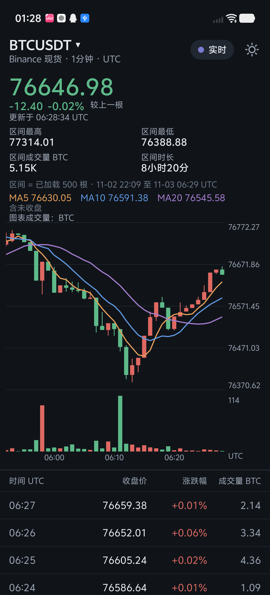
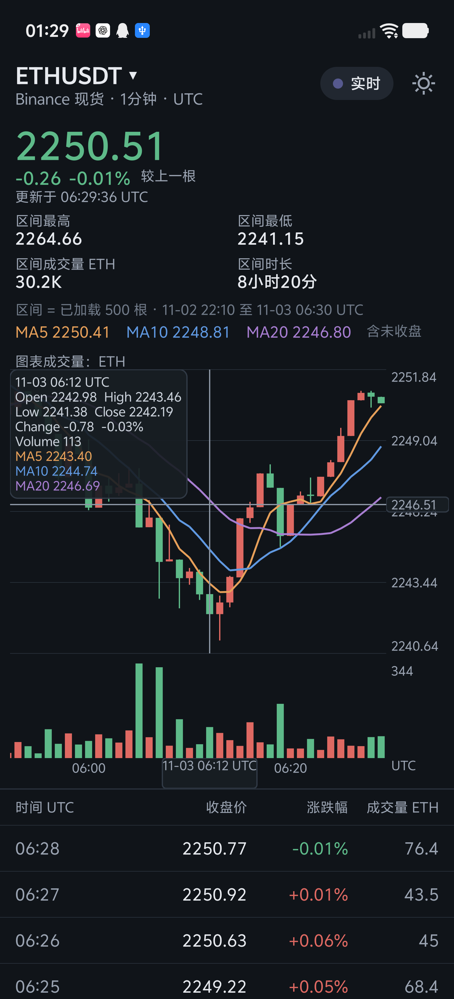
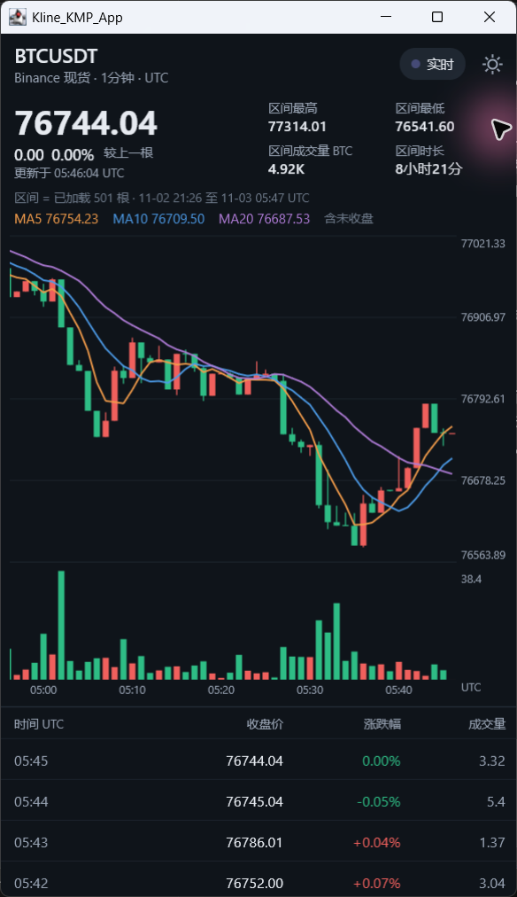

# Kline KMP

A Kotlin Multiplatform app for exploring live Binance cryptocurrency candlesticks on Android and Desktop.

| Android live market | Android crosshair | Desktop |
| :---: | :---: | :---: |
|  |  |  |

The Desktop screenshot was captured before symbol switching was added.

## Features

- Live one-minute BTCUSDT, ETHUSDT and SOLUSDT data from Binance market-data endpoints, with an offline BTCUSDT CSV sample.
- A hand-written Compose Canvas candlestick chart with volume, price and time axes, pan, zoom, crosshair and MA5/10/20.
- A new live session and reset chart selection when switching pairs; volume labels follow the base asset.
- Connection status, retry and last-update information, recent closed candles, English and Chinese UI, and light and dark themes.

## Architecture

```text
Binance WebSocket ──┐
                    ├─> LiveMarketHolder ──> StateFlow<LiveState> ──> Compose UI
Binance REST ───────┘       (single state owner)                       │
                                                                  Canvas chart
Offline BTC CSV ─────────────────────────────────────────────────────> UI
```

The live session subscribes to the WebSocket before fetching a REST snapshot, buffers updates and reconciles them with the snapshot. Ktor CIO handles network requests; one state owner serializes incoming events and publishes immutable state through `StateFlow`. The UI collects that state. Switching pairs creates a fresh holder. The offline sample is clearly labeled and never presented as another pair's data.

The offline benchmark dataset was downloaded on 2026-11-03 at 08:44:29 -05:00 from Binance's market-data REST endpoint. The downloader checks that the requested closed candles are consecutive. Download command and output: [dataset-download.txt](docs/perf/results/dataset-download.txt).

```powershell
python scripts/download_sample.py --benchmark-5000
```

## Run on Windows

Install Android Studio with the Android SDK (compile SDK 37) and a JDK. The Gradle daemon is configured for Azul JDK 21; the wrapper can download the configured toolchain. Android Studio can configure the SDK path in `local.properties`. The Gradle wrapper and dependencies require network access on first use.

Build the Android debug APK:

```powershell
gradlew.bat :androidApp:assembleDebug
```

Run on an attached Android device from Android Studio, or install the debug APK produced in `androidApp/build/outputs/apk/debug/`. Run the Desktop app:

```powershell
gradlew.bat :desktopApp:run
```

Run the shared tests:

```powershell
gradlew.bat :shared:jvmTest :shared:testAndroidHostTest
```

The Gradle XML reports from **2026-11-03** contain 50 Desktop JVM tests and 49 Android host tests, with zero failures, errors or skips. The reports are under `shared/build/test-results/jvmTest/` and `shared/build/test-results/testAndroidHostTest/`; these are local build outputs and will be regenerated by Gradle. A subsequent check on that date reported both test tasks up to date.

## Verification

- On an iQOO 15, a network interruption was tested using airplane mode and separately disabling Wi-Fi; the live connection recovered after network access was restored. After recovery, 10 candle open times from the app's synchronization log matched Binance REST, including minutes during the interruption. This comparison covers those open times only; it does not establish that every update or candle value was recovered. The device kept Wi-Fi enabled when airplane mode alone was turned on.
- For BTCUSDT, ETHUSDT and SOLUSDT, four closed candles per pair were compared with Binance REST at matching UTC minutes. Close and volume values matched the displayed precision. Pair switching and crosshair reset were also checked on the device. [Details and screenshots](docs/design/SYMBOL_PLAN.md#acceptance-results).
- Desktop and Android UI checks, screenshot inspection and known test coverage are recorded in [UI verification](docs/design/VERIFICATION.md).

## Measured Android performance

On a V2505A running Android 16, the non-debuggable benchmark build with R8 disabled was tested using offline data and repeated scripted chart drags. With adaptive refresh enabled, the system reported 60.000004 Hz in each mid-run display snapshot. Across five runs per combination, the median gfxinfo janky-frame percentage was 2.60% for 500 candles at 8 dp, 2.82% for 500 at 2 dp, 1.96% for 5,000 at 8 dp, and 2.82% for 5,000 at 2 dp. These figures describe the app-wide measurement windows on this device, not a guarantee for other devices. Percentiles use histogram buckets; refresh rate could vary during a gesture. [Commands, each run, frame-time percentiles and limitations](docs/perf/PERF_RESULTS.md#android-drag-test).

In a separate live BTCUSDT run using a rebuilt benchmark APK with diagnostic logging, 60 closed candles matched a later Binance REST response for open time, OHLC and base volume after conversion to the app's numeric representation. The log recorded no reconnect or resynchronization during this run. TOTAL PSS was 107,962 KiB at the start and 183,534 KiB after the one-hour interval. Two memory snapshots do not establish a leak or peak usage; the candle comparison does not prove every intermediate update was correct. [Raw outputs, provenance and limitations](docs/perf/PERF_RESULTS.md#live-correctness-and-memory).

## How this project was built

This app was built in an AI-native workflow: AI coding agents (mainly Codex) wrote most of the code, while I owned the specification, the design decisions, the review and the verification.

- **Spec before code.** Each milestone started from a written plan with explicit scope and acceptance criteria, committed to the repository: [M1](M1_PLAN.md)–[M4](M4_PLAN.md), the [UI spec](docs/design/UI_SPEC.md), [symbol switching](docs/design/SYMBOL_PLAN.md) and [performance measurement](docs/perf/PERF_PLAN.md).
- **Design decisions are mine.** Before each milestone the agent questioned me one design decision at a time, for example Double versus fixed-point prices, whether a bad CSV row fails the whole file, subscribing to the WebSocket before taking the REST snapshot, how to order conflicting candle versions, and whether a moving average may span a missing minute. I chose, and the choice went into the plan.
- **Standing rules for the agent.** No number may appear in docs or reports unless it comes from a command that was actually run; the chart is hand-written with no chart library; the app is display-only; new dependencies need my approval; work stops at the end of each milestone for review.
- **Verification gates.** Test counts are read from Gradle's XML reports. Behavior is checked on a physical Android phone with screenshots, live data is cross-checked against Binance REST, and network recovery was tested with a real airplane-mode outage.
- **Review after implementation.** After each milestone I reviewed the actual code question by question. These reviews found and fixed real defects, including a last-update time that could move backwards, a reconnect timer that counted handshake time as stable connection time, axis labels that could draw outside the chart, and pan and zoom gestures restarted by every new candle. Findings that were not fixed are listed under Known limits.
- **Cross-checking between assistants.** UI design was specified in a separate assistant session and implemented by Codex; plans and reports were reviewed against the repository before I approved them.

## Known limits

- Known time gaps and contradictory versions trigger resynchronization; a REST snapshot may itself lag, and undetectable missing updates cannot be ruled out. Background repair, rate-limit cooldown, source selection, proactive connection rotation, history trimming and bad-message thresholds are planned, not implemented.
- Live candle history has no in-memory size limit. The offline sample is a fixed BTCUSDT snapshot, not live data. Rerunning `python scripts/download_sample.py` replaces it with new data; the script is not run by Gradle. Its server-time-before-klines check conservatively classifies closed candles but cannot guarantee the exchange has finished aggregation.
- Android portrait orientation may be ignored on large screens. A light launch background can briefly appear before the app theme loads, and the in-app theme selection is not saved across restarts.
- On the tested iQOO 15, airplane mode did not disable Wi-Fi; disable Wi-Fi separately when testing interruption and restore the original settings afterward.
- Android 13 themed icons fall back to the regular launcher icon because no monochrome layer is provided.

This app displays cryptocurrency market data only. It does not offer trading or investment advice and is not affiliated with Binance or Futu.
